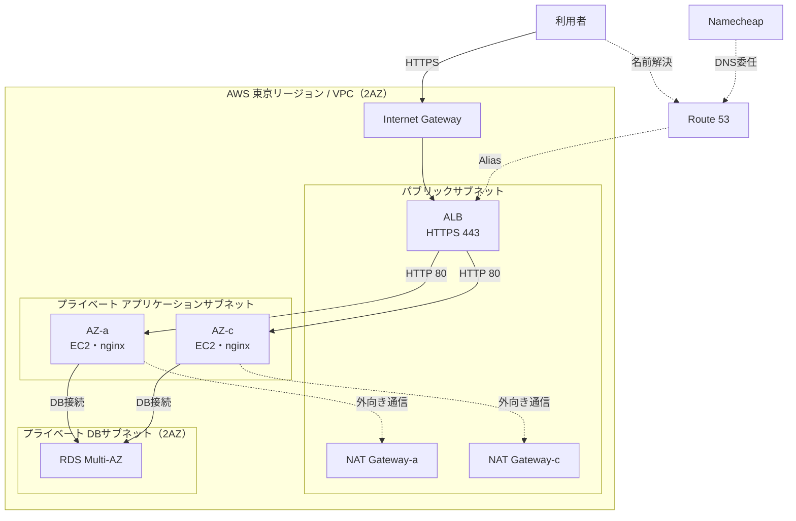

# 卒業制作 インフラ基本設計書

## 1. 概要

卒業制作WebアプリケーションをAWS上で公開するための基本設計を示す。東京リージョン（ap-northeast-1）の2つのアベイラビリティゾーン（AZ）にシステムを配置し、冗長性・可用性・セキュリティを考慮した構成とする。

### 前提

- 独自ドメインはNamecheapで取得し、DNSをRoute 53へ委任する。
- WebサーバーはAmazon Linux 2023上のnginx、データベースはAmazon RDSを利用する。
- RDSのエンジンや各リソースのサイズは、アプリケーション要件と予算に応じて決定する。
- 限られた人のみに公開し、QRコードのトークン方式を採用して認証を行う。

## 2. システム構成

利用者は独自ドメインからALBへHTTPS接続する。ALBがTLSを終端し、プライベートサブネット上のEC2へ転送する。EC2上のアプリケーションはプライベートなRDSへ接続する。EC2とRDSにパブリックIPアドレスは割り当てない。

### AWSリソース

| 分類 | リソース | 構成 |
| --- | --- | --- |
| ネットワーク | VPC・サブネット | VPCを1つ作成し、2AZにパブリック、アプリケーション、DBサブネットを配置 |
| ネットワーク | Internet Gateway・NAT Gateway | Internet GatewayをVPCに接続。NAT Gatewayは各AZへの配置を基本とする |
| 負荷分散 | ALB | internet-facing、2AZ、HTTPSリスナー |
| コンピュート | EC2・Auto Scaling group | 最小スペックのEC2を2台配置。Auto Scalingの最大台数は2台 |
| データベース | Amazon RDS | 最小スペック、プライベート配置、Multi-AZ、ストレージ暗号化 |
| DNS・証明書 | Route 53・ACM | DNS管理、ALBへのAlias、独自ドメイン証明書 |
| 秘密情報 | AWS Secrets Manager | DB認証情報を保管し、EC2のIAMロールから取得 |

## 3. ネットワーク設計

サブネットのCIDRは以下を例とし、既存ネットワークと重複しないことを確認して確定する。

| サブネット | CIDR例 | AZ | 用途 |
| --- | --- | --- | --- |
| Public-a | 10.0.0.0/24 | AZ-a | ALB、NAT Gateway |
| Public-c | 10.0.1.0/24 | AZ-c | ALB、NAT Gateway |
| App-a | 10.0.10.0/24 | AZ-a | EC2 |
| App-c | 10.0.11.0/24 | AZ-c | EC2 |
| DB-a | 10.0.20.0/24 | AZ-a | RDS subnet group |
| DB-c | 10.0.21.0/24 | AZ-c | RDS subnet group |

- パブリックサブネットのデフォルトルートはInternet Gatewayへ向ける。
- アプリケーションサブネットのデフォルトルートは同じAZのNAT Gatewayへ向ける。
- DBサブネットにはInternet Gateway、NAT Gatewayへのデフォルトルートを設定しない。
- 初期構成はIPv4とする。

## 4. 通信・セキュリティ

セキュリティグループでは必要な通信のみ許可し、接続元は可能な限りセキュリティグループで指定する。

| 対象 | 方向 | 通信 | 接続元・接続先 |
| --- | --- | --- | --- |
| ALB | 受信 | TCP 443、TCP 80 | インターネット（80はHTTPS転送のみ） |
| ALB | 送信 | TCP 80 | EC2用セキュリティグループ |
| EC2 | 受信 | TCP 80 | ALB用セキュリティグループ |
| EC2 | 送信 | DBポート、TCP 443 | RDS用セキュリティグループ、外部HTTPS |
| RDS | 受信 | DBポート | EC2用セキュリティグループ |

- SSH（TCP 22）はインターネットに公開しない。EC2の管理接続にはSystems Manager Session Managerを使用する。
- RDSのPublicly accessibleを無効にする。
- AWS操作には個人別の認証を利用し、EC2には最小権限のIAMロールを割り当てる。
- DB認証情報やアクセスキーをソースコード、インスタンス内に直接保存しない。
- 利用者からALBまではHTTPS（TLS 1.2以上）を使用する。ALBからEC2はプライベートネットワーク内のHTTPを基本とする。
- RDSとEC2のストレージは暗号化する。

## 5. EC2設計

- EC2を2台、異なるAZのアプリケーションサブネットに1台ずつ配置する。
- インスタンスタイプとストレージは、選定できる中での最小スペックのものとする。
- Auto Scaling groupの希望容量と最小台数は2台、最大台数も2台とする。
- インスタンス内に永続データを保存しない。

## 6. Webサーバー(nginx)

- nginxはTCP 80でアプリケーションのWeb要求を受け付ける。
- ALBターゲットグループはHTTP、ポート80とする。
- ヘルスチェックには、アプリケーションの稼働を確認できる専用パス（例：`/health`）を使用する。

## 7. RDS設計

- 最小スペックのインスタンスクラスとストレージ容量を採用する。
- DB subnet groupはDB-a、DB-cを含む2AZで作成する。
- Multi-AZ配置を有効にし、AZ障害時はAWS管理の待機系へフェイルオーバーする。
- RDSはプライベート配置とし、Publicly accessibleを無効にする。接続元はEC2に限定する。
- アプリケーションはRDSのエンドポイント名を使用し、インスタンス固有のIPアドレスを設定しない。

## 8. DNS・HTTPS

- Namecheapで取得したドメインのDNSをRoute 53へ委任し、ALB宛てのAliasレコードを設定する。ALBのIPアドレスは固定登録しない。
- ACMで独自ドメインの証明書を発行し、ALBのHTTPS（443）リスナーに設定する。
- ACMのDNS検証用CNAMEレコードを維持し、証明書の自動更新を有効にする。証明書の秘密鍵はEC2へ配布しない。
- HTTP（80）はHTTPSへリダイレクトする。

## 9. QRコード認証（採用する場合）

- QRコードには、有効期限と失効手段を設けた推測困難なトークンを含める。QRを所持する人は有効期間中アクセスできるため、個人の本人確認にはならない。
- トークンはサーバー側で生成し、DBにはハッシュ値と有効期限・状態を保存する。平文のトークンやセッションCookieをログに記録しない。
- 認証成功後はトークンをURLから除去し、Secure、HttpOnly、SameSite属性を設定したセッションCookieを使用する。
- トークンの利用回数、セッション有効期限、再発行時の旧トークンの扱いは要件確定時に決定する。

## 10. バックアップ・保守

定期的なバックアップ、保守作業、更新運用は基本的に行わない。TLS証明書はACMの自動更新を利用する。

## 11. 未確定事項

- 独自ドメインと証明書に含めるホスト名
- アプリケーションの実行方式とnginxからの接続方式
- NAT Gatewayを各AZに配置する費用
- QRコード認証を採用する場合のトークン・セッション要件

以上
