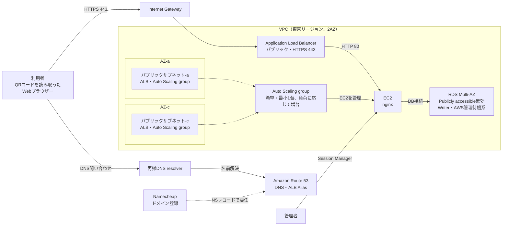

# 卒業制作 インフラ基本設計書

## 文書概要

### 目的
本書は、卒業制作WebアプリケーションをAWS上で稼働させるためのインフラ基本設計を定義する。
インターネットからのHTTPSアクセスを受け付け、パブリックサブネット上のWebサーバーと、外部公開を無効にしたデータベースへ接続する。

### 対象範囲
- AWSネットワーク（VPC、サブネット、ルーティング）
- Application Load Balancer（ALB）
- Auto Scaling groupで管理するWebサーバー用EC2インスタンス（nginx、通常1台）
- リレーショナルデータベース（RDS）1系統
- QRコードを用いたトークン認証、TLS証明書、セキュリティ、可用性、バックアップ、監視

### 前提・要確認事項
- AWSリージョンは東京（ap-northeast-1）を前提とする。
- 本番相当環境は2つのアベイラビリティゾーン（AZ）に分散する。
- 独自ドメインはNamecheapで取得する。Amazon Route 53にホストゾーンを作成し、Namecheap側でRoute 53のネームサーバーへ委任する。
- Route 53のAliasレコードからALBへ接続し、ALBのIPアドレスを直接登録しない。ALBのIPアドレス変更はDNS Aliasによって吸収する。
- QRコードには認証用の秘密トークンを含むURLを格納する。QRコードを読み取った人は、そのトークンが有効な間、所定のコンテンツへアクセスできる。
- QRトークンの有効期間、再利用可否、発行・失効権限は未確定とし、アプリケーション要件に基づき決定する。
- WebサーバーはAmazon Linux 2023上でnginxを稼働させる。
- RDSのエンジン、インスタンスサイズ、ストレージ容量はアプリケーション要件と予算を確認して確定する。MySQLまたはPostgreSQLを候補とする。
- RDSの「1台」は1つのDBインスタンス（Writer）を指す。Multi-AZ構成ではAWS管理の待機系が別AZに作成される。
- EC2はパブリックサブネットに配置し、Auto Scaling groupの希望容量・最小容量を1台とする。最大容量は予算と負荷に応じて設定する。
- VPC内にプライベートサブネットは作成しない。RDS用DB subnet groupには異なるAZのパブリックサブネットを使用し、RDSのPublicly accessibleは無効にする。
- 開発／検証環境は本番環境と分離し、必要な可用性に応じて構成を縮小する。

## システム構成

### 構成概要
利用者はRoute 53でドメイン名を名前解決し、HTTPSでALBへアクセスする。
ALBはTLSを終端し、HTTPでパブリックサブネット上のAuto Scaling group配下のEC2へ転送する。通常の稼働台数は1台とし、負荷に応じて増台する。
アプリケーションはQRコードから渡されたトークンを検証し、認証済みセッションを確立する。EC2上のアプリケーションはDB接続情報を安全に取得して、Publicly accessibleを無効にしたRDSへ接続する。
EC2にはパブリックIPv4アドレスを割り当てるが、セキュリティグループで受信元をALBに限定し、インターネットからの直接接続を許可しない。RDSはPublicly accessibleを無効にし、DBポートの接続元をEC2用セキュリティグループに限定する。ALBは公開エンドポイントとして利用者からのHTTPSアクセスを受け付ける。

### 論理構成図

注：Namecheapはドメイン登録とDNS委任設定に使用し、利用者からの名前解決はRoute 53が応答する。ALBとAuto Scaling groupは異なるAZのパブリックサブネットを使用する。EC2の通常台数は1台で、負荷に応じて同じパブリックサブネット群内で増減する。RDS用DB subnet groupも2AZにまたがるパブリックサブネットで構成するが、RDSのPublicly accessibleは無効にする。AZ名は説明用であり、実際のAZ IDはアカウントごとに確認する。

### AWSリソース一覧

| 分類 | リソース | 基本設計 |
|---|---|---|
| ネットワーク | VPC | 1つ。IPv4 CIDRは例として10.0.0.0/16 |
| ネットワーク | パブリックサブネット | 2つ。異なるAZに配置し、ALB、Auto Scaling group配下のEC2、RDS用DB subnet groupに使用 |
| ネットワーク | Internet Gateway | VPCに1つアタッチ |
| 負荷分散 | Application Load Balancer | internet-facing、2AZ、HTTPSリスナーを構成 |
| コンピュート | EC2 | パブリックサブネットに通常1台。nginxを稼働し、パブリックIPv4を割り当てる。受信はALB用セキュリティグループに限定 |
| コンピュート | Auto Scaling group | 希望容量1、最小1。負荷に応じて増台し、最大容量は予算に応じて設定。異常時は自動置換 |
| データベース | Amazon RDS | 異なるAZのパブリックサブネットを使うDB subnet groupに配置。Publicly accessible無効、Multi-AZ有効、暗号化有効 |
| 証明書 | AWS Certificate Manager（ACM） | 東京リージョンで独自ドメイン用のパブリック証明書を発行・自動更新 |
| DNS | Amazon Route 53 | Namecheapで取得した独自ドメインのDNSを管理し、AliasレコードでALBへ接続 |
| 認証 | アプリケーション | QRトークンの発行、検証、失効およびセッション管理 |
| 運用 | AWS Systems Manager | Session Managerによる管理接続、Patch Managerによる更新管理 |
| 運用 | Amazon CloudWatch | メトリクス、ログ、アラームを管理 |
| 保管 | Amazon S3 | ALBアクセスログ等の保管先。パブリックアクセスを遮断 |
| 秘密情報 | AWS Secrets Manager | DB認証情報を保管し、EC2のIAMロールで取得 |

## ネットワーク設計

### アドレス設計例
以下は設計例である。既存ネットワークとの重複がないことを確認してから確定する。

| サブネット | CIDR例 | AZ | 用途 |
|---|---|---|---|
| Public-a | 10.0.0.0/24 | AZ-a | ALB、Auto Scaling group配下のEC2、RDS subnet group |
| Public-c | 10.0.1.0/24 | AZ-c | ALB、Auto Scaling group配下のEC2、RDS subnet group |

### ルート設計
- パブリックサブネットのデフォルトルート（0.0.0.0/0）はInternet Gatewayへ向ける。EC2のパブリックIPv4を介して外向き通信を行う。
- RDSはPublicly accessibleを無効にし、セキュリティグループでEC2からのDB接続だけを許可する。サブネットの経路がInternet Gateway向けであっても、外部からのDB接続は許可しない。
- VPC内通信はローカルルートを使用する。
- IPv6を利用する場合は、IPv6 CIDR、ルート、セキュリティグループ、監視を追加設計する。初期構成ではIPv4を使用する。

## 通信・セキュリティ設計

### セキュリティグループ
VPC内のセキュリティグループは必要最小限の通信のみ許可する。送信元にはIPアドレス範囲ではなく、可能な限り接続元のセキュリティグループまたはAWS管理プレフィックスリストを指定する。

| 対象 | 方向 | 許可する通信 | 接続元／接続先 |
|---|---|---|---|
| ALB | 受信 | TCP 443 | インターネット（0.0.0.0/0） |
| ALB | 受信 | TCP 80 | インターネット（HTTPSへのリダイレクト用途のみ） |
| ALB | 送信 | TCP 80 | EC2用セキュリティグループ |
| EC2 | 受信 | TCP 80 | ALB用セキュリティグループのみ |
| EC2 | 送信 | DBポート | RDS用セキュリティグループのみ |
| EC2 | 送信 | TCP 443 | AWS Systems Manager等への管理・更新通信 |
| RDS | 受信 | DBエンジンのポート | EC2用セキュリティグループのみ |

管理用SSH（TCP 22）はインターネットから許可しない。EC2への管理接続はSystems Manager Session Managerを使用し、EC2用IAMロールとパブリックIPv4経由のHTTPS（443）通信、または必要なVPCエンドポイントを設定する。
RDSはPublicly accessibleを無効にし、DB用セキュリティグループの受信元をEC2用セキュリティグループに限定する。EC2はパブリックIPv4を持つが、インターネットからの直接接続はセキュリティグループで許可しない。

### IAM・認証情報
- 人のAWS操作には個人別IAM Identity Center等を利用し、共有アカウントを避ける。
- EC2には用途を限定したIAMロールを割り当てる。アクセスキーをインスタンスやソースコードに保存しない。
- DB認証情報はSecrets Managerに保管し、アプリケーションはIAMロールを用いて取得する。
- IAMポリシーは最小権限とし、不要になった権限・認証情報を削除する。

### 暗号化
- 利用者からALBまではHTTPS（TLS 1.2以上を基本）で暗号化する。
- ALBからEC2はVPC内通信のHTTPを基本とし、EC2用セキュリティグループの受信元をALB用セキュリティグループに限定する。要件に応じてターゲット側もHTTPS化する。
- RDSのストレージ、EC2のEBSボリューム、バックアップを暗号化する。
- RDS接続のTLS利用可否は選定したエンジンとアプリケーションドライバーで確認し、有効化する。
- ALBアクセスログやアプリケーションログをS3に保存する場合は暗号化を有効にする。

## DNS・HTTPS設計

### DNS・ALB
- [Namecheap公式サイト](https://www.namecheap.com/)で独自ドメインを取得し、Route 53にパブリックホストゾーンを作成する。
- Route 53が払い出すネームサーバー（NS）レコードをNamecheapのドメイン設定に登録し、DNSをRoute 53へ委任する。
- Route 53にALB宛てAliasレコードを作成し、独自ドメインからALBへ名前解決する。ALBのIPアドレスをAレコードへ固定登録しない。ALBのIPアドレスが変わってもAliasレコードで追従する。
- ALBはinternet-facingとし、2AZのパブリックサブネットに配置する。

### 証明書の取得・自動更新
- 東京リージョン（ap-northeast-1）のACMで、ALBに設定する独自ドメイン（例：www.example.jp）のパブリック証明書をリクエストする。
- ACMのDNS検証用CNAMEレコードをRoute 53のホストゾーンに登録し、証明書発行後も削除せず維持する。
- 発行された証明書をALBのHTTPS（443）リスナーに関連付ける。証明書の秘密鍵をEC2へ配布・保存しない。
- ACMが発行した証明書をALBで利用し、DNS検証用CNAMEレコードを維持することでACMの自動更新を可能にする。証明書の状態と更新通知を監視する。
- Namecheapでのドメイン登録更新はACM証明書更新とは別に管理し、ドメインの有効期限切れを防止する。

### リスナー・HTTPS
- HTTPS（443）リスナーはACM証明書を使用し、TLSポリシーを設定する。
- HTTP（80）リスナーはHTTPS（443）へリダイレクトする。HTTPでアプリケーションの内容を配信しない。
- ALBからEC2はVPC内通信のHTTP（80）を基本とし、EC2用セキュリティグループの受信元をALB用セキュリティグループに限定する。
- アプリケーションがリバースプロキシ配下で正しい接続情報を認識するよう、X-Forwarded-For、X-Forwarded-Proto等を適切に扱う。

## QRコード・トークン認証設計

### 認証方式
- QRコードには、HTTPSの認証開始URLと暗号学的に安全な乱数生成器で生成した256ビットの推測困難なBearer tokenを格納する。
- QRコードを所持することはトークンを所持することと同等であり、トークンが有効な期間は、そのURLを知る人がアクセスできる。
- この方式はQRコードを読み取った端末の利用者を個人として識別するものではない。QR画像やURLが共有・撮影された場合、他者もアクセスできる。
- 発行者を管理者等に限定し、トークンに有効期限を設定する。紛失・漏えい時に個別失効できるようにする。

### 発行・検証・セッション
- トークンはサーバー側で生成し、平文のままデータベースへ保存しない。RDSにはトークンのハッシュ値、発行日時、有効期限、状態（有効／失効／使用済み）等を保存する。
- QRのURLにはフラグメント（#以降）でトークンを渡す。フラグメントは通常のHTTPリクエストやRefererに含まれない。認証開始ページは外部リソースを読み込まず、ページ上の処理でトークンを取得後、認証APIへHTTPSのPOST本文として送信する。
- アプリケーションは受信トークンをハッシュ化し、有効期限、失効状態、利用回数の条件を検証する。条件を満たさない場合はアクセスを拒否する。
- 認証成功時はトークンをブラウザーのURL・表示履歴から除去し、Secure、HttpOnly、SameSite属性を設定したセッションCookieを発行する。以後のアクセスはサーバー側セッションで認証する。
- トークンとセッションCookieはアクセスログ、アプリケーションログ、解析ログへ出力しない。トークン検証応答と認証後ページはブラウザーでキャッシュしない（Cache-Control: no-store）。
- CSRF対策、セッション有効期限、ログアウト時のセッション無効化、失敗回数制限をアプリケーション側で実装する。

### 利用回数・運用
- トークンを一回限りにするか、有効期限内に複数回利用可能にするかは要件確定が必要である。
- 一回限りの場合は、同時アクセス時にも重複使用を防ぐ原子的な状態更新を行う。
- 複数回利用を許可する場合は、利用期限・失効操作・発行数制限を設ける。
- QRコードの再発行時は旧トークンの失効方針を定める。トークン発行・失効操作を監査ログへ記録する。ただし監査ログに秘密のトークン値は記録しない。

## EC2・Webサーバー設計

### インスタンス
- Auto Scaling groupに異なるAZのパブリックサブネット（Public-a、Public-c）を登録し、希望容量1、最小容量1で起動する。EC2にパブリックIPv4を自動割り当てし、受信通信はALB用セキュリティグループに限定する。
- インスタンスタイプ、CPU、メモリ、EBS容量は負荷試験と予算をもとに選定する。
- AMIはAmazon Linux 2023を基本とし、更新済みのAMIから構築する。
- Auto Scaling groupの最大容量は予算に応じて設定する。CPU平均使用率等を指標にしたターゲット追跡スケーリングを設定し、ヘルスチェック異常時はインスタンスを自動置換する。スケーリング閾値は負荷試験で調整する。
- 通常1台のため、EC2障害時は置換が完了するまで停止または縮退が発生する。無停止に近い可用性が必要な場合は最小容量2以上を検討する。
- インスタンス内に永続データを保存しない。必要な永続データはRDSまたはS3等に保存する。

### nginx・ターゲットグループ
- nginxはTCP 80でアプリケーションのWeb要求を受け付ける。
- ALBターゲットグループのプロトコルはHTTP、ポートは80とする。
- ヘルスチェックはアプリケーションの稼働を確認できる専用パス（例：/health）を使用する。
- ヘルスチェック応答にDB障害を含めるかは、障害時に全台をターゲットから外してしまわないようアプリケーション要件に応じて決定する。
- nginxおよびアプリケーションの設定、ログ出力、更新手順を標準化する。

## RDS設計

### 可用性・接続
- DB subnet groupはPublic-a、Public-cを含む2AZで作成する。
- 本番相当環境ではMulti-AZ配置を有効化し、AZ障害時にAWS管理の待機系へフェイルオーバーできるようにする。
- アプリケーションはRDSのエンドポイント名を使用し、インスタンス固有のIPアドレスを設定しない。
- RDSのPublicly accessibleは無効とし、DBポートへの接続元をEC2用セキュリティグループに限定する。RDS用サブネットのルートテーブルがInternet Gateway向けでも、公開アクセスは許可しない。
- エンジン、メジャー／マイナーバージョン、インスタンスクラス、ストレージ種別・容量、最大容量を要件に基づき決定する。

### バックアップ・保守
- 自動バックアップを有効化し、保持期間は初期値として7日を設定する。必要な復旧期間・予算に応じて調整する。
- ポイントインタイムリカバリを利用可能な状態にする。
- 重要な節目では手動スナップショットを取得し、削除保護を有効化する。
- メンテナンス時間帯を定義し、エンジン更新や再起動の影響を確認する。
- バックアップからの復元およびMulti-AZフェイルオーバーの確認を定期的に実施する。

## 運用・変更管理

- EC2のOSおよびnginxを定期的に更新し、適用前に検証環境で動作確認する。
- EC2への管理接続はSession Managerを使用し、操作ログを記録する。
- アプリケーションの配布手順、ロールバック手順、環境変数・秘密情報の更新手順を整備する。
- インフラ変更は変更内容、影響範囲、実施者、実施日時、切り戻し方法を記録する。
- AWSアカウントのルートユーザーにMFAを設定し、日常運用に使用しない。
- AWS利用料金と予算アラートを設定し、Auto ScalingによるEC2増台、RDS Multi-AZ、ログ保管による継続費用を確認する。

## 未確定事項・次工程

- 取得するドメイン名およびACM証明書に含めるホスト名（例：www.example.jp、必要に応じてexample.jpも追加）
- RDSエンジン、バージョン、インスタンスクラス、容量、DBポート
- EC2インスタンスタイプ、EBS容量、Auto Scalingの上限
- アプリケーション実行方式、nginxからアプリケーションへの接続方式
- バックアップ保持期間
- Auto Scaling groupの最大容量とスケーリング閾値
- ALBからEC2間の通信をHTTPSにする必要性
- QRトークンの有効期間、一回限り／複数回利用の別、発行・失効権限
- 認証済みセッションの有効期限と再認証要否
- AWS WAFの適用要否、レート制限等のルール

以上
