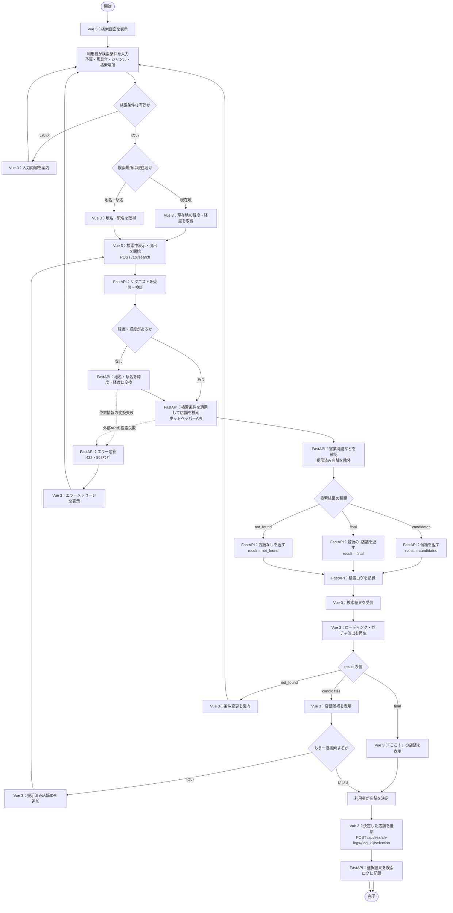

# Vue 3・FastAPI 店舗検索フローチャート

## 処理の流れ

## 担当する処理

| 担当 | 処理 |
| --- | --- |
| Vue 3（フロントエンド） | 検索条件の入力、現在地または地名・駅名の指定、API呼び出し、待ち時間や結果の演出、店舗の表示、決定結果の送信 |
| FastAPI（バックエンド） | 入力の検証、地名・駅名の位置情報変換、店舗検索と条件の適用、提示済み店舗の除外、結果・検索ログの返却 |
| 外部サービス | Photonによる地名・駅名の位置情報変換、ホットペッパーAPIによる店舗情報の検索 |

## APIのやりとり

1. Vue 3は検索条件を`POST /api/search`へ送信する。検索条件には予算、腹具合、ジャンル、検索位置、提示済み店舗IDを含める。
2. FastAPIは検索を行い、結果の`result`が`candidates`、`final`、`not_found`のいずれかであるレスポンスを返す。
3. Vue 3はレスポンスを受け取ってから演出を行い、返された店舗情報を表示する。演出は画面上の表現であり、検索処理や待ち時間をFastAPI側で行うものではない。
4. シャッフル時はVue 3が提示済み店舗IDを追加し、同じ`POST /api/search`を再度呼び出す。
5. 利用者が店舗を決定した場合は、レスポンスの`log_id`を使って`POST /api/search-logs/{log_id}/selection`へ店舗IDを送信する。

検索エンドポイント、リクエスト項目、および結果の種類は[backend/README.md](./backend/README.md)に記載されたAPI仕様に合わせています。
